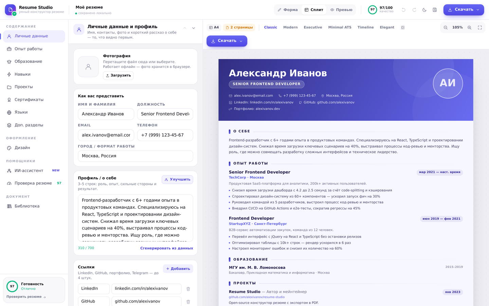
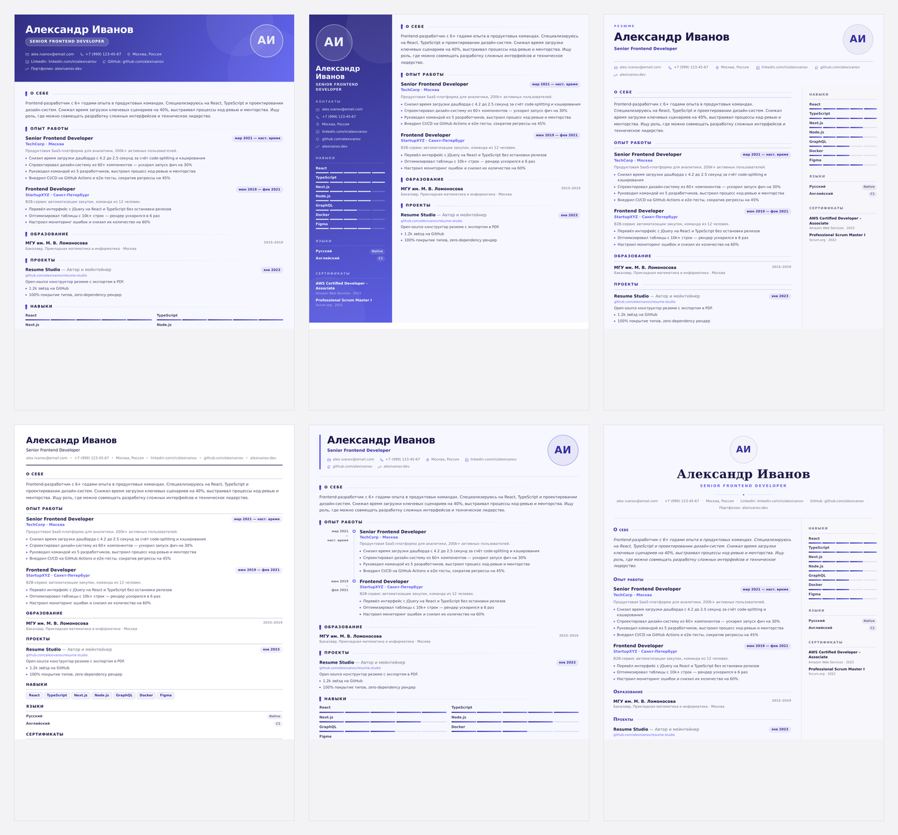
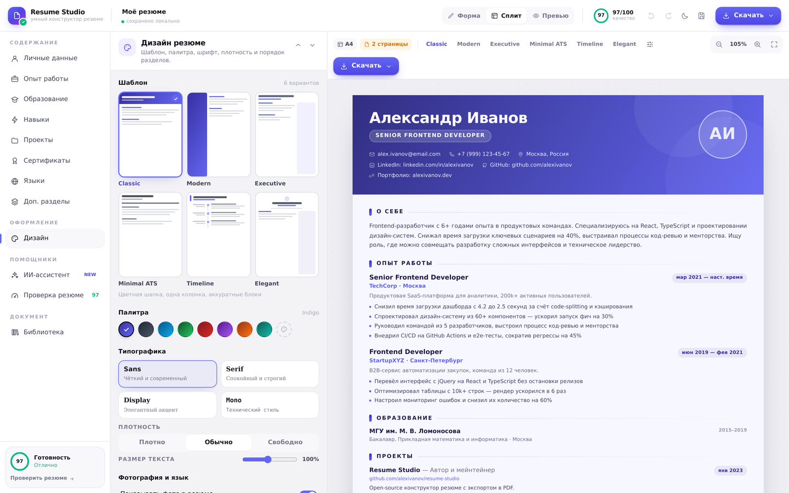
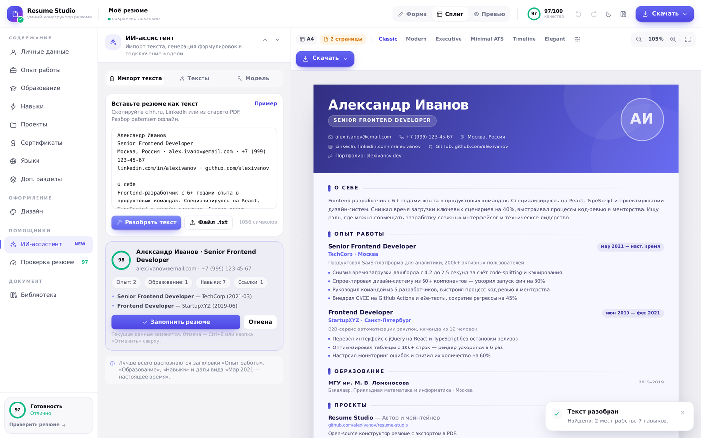
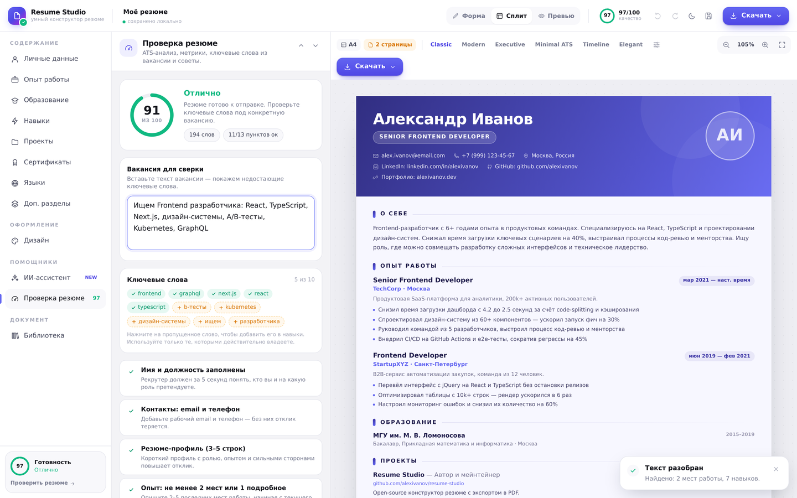

# Resume Studio — умный конструктор резюме

Редактор резюме с живым предпросмотром A4, шестью шаблонами, ИИ-помощником и проверкой под ATS.
React 18 + TypeScript + Vite + Tailwind + Zustand. Всё работает в браузере, без бэкенда.



## Шесть шаблонов



| | |
| --- | --- |
|  |  |
|  | |

---

## ✨ Возможности

### Содержание и структура
- **12 разделов**: личные данные, профиль, опыт, образование, навыки, проекты, сертификаты, языки и **свои разделы** (публикации, выступления, волонтёрство).
- **Порядок и видимость разделов** — переключаются в «Дизайне».
- Достижения с измеримым результатом, ссылки, фото, локация, формат работы.
- **Библиотека версий** под разные вакансии: сохранить, открыть, дублировать, удалить.
- **Импорт/экспорт JSON** и **Markdown** — бэкап и перенос между устройствами.
- **Undo/Redo** на 60 шагов, автосохранение в `localStorage`.
- Миграция данных из предыдущей версии (`resume-builder-v2`).

### Дизайн
- **6 шаблонов**: Classic, Modern (тёмный сайдбар), Executive, Minimal ATS, Timeline, Elegant.
- **8 палитр** + свой акцентный цвет.
- **4 шрифта** (Inter, Source Serif, Playfair Display, JetBrains Mono), плотность, масштаб текста.
- Форма фото (круг / скругление / квадрат) и возможность скрыть его.
- Язык заголовков **RU / EN**.
- Светлая и тёмная тема интерфейса.
- Предпросмотр с **границами страниц A4**, счётчиком страниц и зумом «по размеру».

### ИИ-помощник
- **Импорт из текста** — вставьте резюме с hh.ru / LinkedIn / старого PDF, парсер разложит его по полям (офлайн, без отправки данных).
- **Генерация профиля**, **достижения для места работы**, **переписывание формулировок**, **перевод резюме**, **сопроводительное письмо** под вакансию.
- **Офлайн-режим без ключа**: подсказки навыков по профессии, готовые формулировки достижений, генерация профиля из ваших же данных.
- **Свой ключ**: любой OpenAI-совместимый endpoint (OpenAI, OpenRouter, Groq, Together, Ollama, LM Studio). Ключ хранится только в `localStorage` браузера.

### Проверка резюме
- Оценка **0–100** по 12 критериям: контакты, профиль, достижения, метрики, глаголы действия, объём, навыки, заглушки.
- **Сверка с вакансией**: совпавшие и пропущенные ключевые слова (пропущенное добавляется в навыки в один клик).
- Подсказки к каждому пункту — что именно улучшить.

### Экспорт
- **PDF с текстовым слоем** через печать — выделяемый текст, идеален для ATS.
- **PDF-изображение** (html2canvas + jsPDF) — точная копия вёрстки, умные переносы страниц без разрезания строк.
- **PNG** высокого разрешения, **JSON**, **Markdown**.
- Индикатор многостраничности и предупреждение о переполнении.

### UX
- Режимы **Форма / Сплит / Превью**, адаптив под мобильные.
- Тосты, пустые состояния, клавиатурные сокращения.
- Офлайн-работа: единственный внешний ресурс — Google Fonts (есть системные фолбэки).

---

## 🚀 Быстрый старт

```bash
npm install
npm run dev      # http://localhost:5173
npm run build    # production build в dist/
npm run preview  # локальный предпросмотр сборки
```

Требуется Node 18+.

### Полезные скрипты

| Скрипт | Что делает |
| --- | --- |
| `npm run typecheck` | Проверка типов без сборки |
| `npm run check:templates` | Рендер всех шаблонов/палитр/шрифтов + прогон парсера и ATS-анализа (smoke-тест) |
| `npm run check:app` | SSR-прогон приложения и всех вкладок редактора |

---

## ⌨️ Горячие клавиши

| Клавиши | Действие |
| --- | --- |
| `Ctrl/⌘ + Z` | Отменить |
| `Ctrl/⌘ + Shift + Z` или `Ctrl/⌘ + Y` | Повторить |
| `Ctrl/⌘ + S` | Сохранить версию в библиотеку |
| `Ctrl/⌘ + P` | Печать → PDF с текстовым слоем |
| `Esc` | Закрыть модальное окно |

---

## 🤖 Как подключить модель

1. Откройте **ИИ-ассистент → Модель**.
2. Выберите провайдера или впишите свой `Base URL` + модель.
3. Вставьте API-ключ и нажмите **«Проверить связь»**.

Поддерживается любой сервис с эндпоинтом `POST {baseUrl}/chat/completions` в формате OpenAI.
Запросы идут напрямую из браузера в выбранный API; ключ не покидает устройство и не попадает в резюме/JSON.

Без ключа приложение полностью работоспособно: парсер, ATS-проверка, подсказки и офлайн-генерация текстов работают локально.

---

## 🗂 Структура проекта

```
src/
├── components/
│   ├── layout/          # TopBar, SideRail, PreviewPane
│   ├── forms/           # вкладки редактора + ai/ (импорт, тексты, модель)
│   ├── templates/       # 6 шаблонов, общие части и рендереры секций
│   ├── ui/              # дизайн-система: Button, Field, Modal, Toast, Icon...
│   ├── App-части: EditorPanel, ResumePreview, TemplateRenderer, PrintRoot, ExportMenu
├── constants/           # шаблоны, палитры, шрифты, демо/пустые данные
├── hooks/               # экспорт, горячие клавиши
├── lib/
│   ├── ai/              # parse.ts (парсер), quality.ts (ATS), suggest.ts, llm.ts
│   ├── export.ts        # PDF/PNG/печать/JSON/Markdown
│   └── sections.ts      # реестр разделов, порядок и видимость
├── store/               # resumeStore (zustand + persist + undo), aiStore
├── types/               # доменные типы
└── utils/               # даты, цвета, файлы, id
```

### Данные

```ts
interface ResumeData {
  personal: { fullName; jobTitle; email; phone; location; photo; links[] };
  summary: string;
  experience: Experience[];
  education: Education[];
  skills: Skill[];
  languages: Language[];
  projects: Project[];
  certifications: Certification[];
  customSections: CustomSection[];
}
```

Настройки оформления (`ResumeConfig`) хранят шаблон, палитру, шрифт, плотность, язык заголовков, форму фото, масштаб текста, порядок и видимость разделов.

---

## 🛠 Стек

| Технология | Назначение |
| --- | --- |
| React 18 + TypeScript | UI и типизация |
| Vite 5 | Сборка и dev-сервер |
| Tailwind CSS 3 | Стили и дизайн-токены (CSS-переменные → светлая/тёмная тема) |
| Zustand + persist | Стейт, автосохранение, библиотека версий |
| html2canvas + jsPDF | Растровый PDF/PNG |
| Native print CSS | Векторный PDF с текстовым слоем |

---

## 🔒 Приватность

- Данные резюме и настройки — в `localStorage` вашего браузера.
- Нет аналитики, трекеров и серверов.
- Внешние запросы: шрифты Google Fonts и — только если вы сами подключили модель — выбранный LLM API.

## 📄 Лицензия

MIT — см. [LICENSE](LICENSE).
